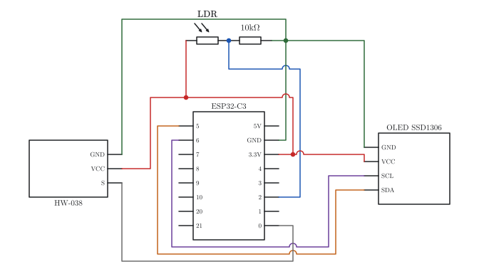

*Planty* is a smart plant monitoring system powered by an ESP32-C3. It tracks your plant's vital signs and displays them locally on a OLED screen and a local web dashboard.


          


## Features
- Dual Sensor Tracking to know exactly what your plant needs
- Live OLED Dashboard right next to your plant
- API with External Dashboard or Local Web Server
- Local storage of recent measurement data


## Hardware
- ESP32 C3 SuperMini
- 0.96-inch OLED display
- LDR
- HW-038 Water Sensor


## How it works
1. Planty boots up, shows his logo on the OLED, mounts LittleFS and connects to your WiFi.
2. Every cycle reads averaged sensor data, maps values to percentages (0-100%), updates the OLED display, and handles incoming web clients.
3. Type the Planty's local IP address into any browser on your home network to check your plant's status.


## Wiring Diagram




## Getting Started
### 1. Configure WiFi Credentials
Create a file named `secrets.h` (or just rename `example_secrets.h`) in your project root directory and add your Wi-Fi details:
```cpp
#define WiFi_SSID "Your_WiFi_Name"
#define WiFi_Password "Your_WiFi_Password"
```

### 2. Configure Dashboard Mode
Edit your new `secrets.h` file and define whether you want to use an external dashboard:
```cpp
#define External_Dashboard false
```
- false: Use the built-in dashboard hosted by the ESP32.
- true: Enable the API for an external dashboard.

### 3. Upload the Web Files
Use the LittleFS Data Upload tool in your Arduino IDE (Cmd + Shift + P -> Upload LittleFS in IDE 2.x) to flash the website files to the ESP32-C3.

### 4. Flash the Code
Open the main sketch in your Arduino IDE, select your ESP32-C3 Dev Module, and upload the code.


## Required Arduino Libraries
Make sure you have the following libraries installed via the Arduino IDE Library Manager:
- `Adafruit GFX Library`
- `Adafruit SSD1306`

The following libraries are included in the ESP32 Arduino Core
and do not require separate installation:
- `WiFi`
- `WebServer`
- `LittleFS`
- `Wire`
- `time.h`

**Note:** Make sure you have the [ESP32 board package by Espressif](https://developer.espressif.com/blog/2025/10/arduino-get-started/#method-1-installation-via-arduino-ide-board-manager)
installed in your Arduino IDE.


## API Endpoints
The ESP32 provides a REST API to access current sensor readings and historical measurement data. All endpoints use HTTP and return JSON responses where applicable.

### `GET /api/status`

Returns the current sensor readings, including soil moisture, light level and the current timestamp.

Example response:

```
{
  "water": 65,
  "light": 78,
  "timestamp": 1794411000
}
```

| Parameter   | Type    | Description                                             |
| ----------- | ------- | ------------------------------------------------------- |
| `water`     | Integer | Current soil moisture level in percent (0–100)          |
| `light`     | Integer | Current light level in percent (0–100)                  |
| `timestamp` | Integer | Current Unix timestamp                                  |

### `GET /api/history`

Returns historical sensor measurements from the last 7 days. The data is read from the locally stored `measurements.csv` file in LittleFS.

Example response:

```
[
  {
    "timestamp": 1794411000,
    "water": 65,
    "light": 78
  },
  {
    "timestamp": 1794421000,
    "water": 62,
    "light": 81
  }
]
```

| Parameter   | Type    | Description                             |
| ----------- | ------- | --------------------------------------- |
| `timestamp` | Integer | Unix timestamp of the measurement       |
| `water`     | Integer | Soil moisture level in percent (0–100)  |
| `light`     | Integer | Light level in percent (0–100)          |

Additional information:

- Measurements are stored locally
- A new measurement is saved every 2 minutes
- Only measurements from the last 7 days are returned

### General information

- Protocol: HTTP
- Port: 80
- Data format: JSON (`application/json`)
- Time format: Unix timestamp (UTC-based seconds)
- Sensor update interval: 2 seconds
- Storage interval: 2 minutes


## Usage of AI

This project was developed with the **assistance of AI tools**. AI was used to support **parts** of the coding, debugging, and implementation process (mostly for HTML, JavaScript and CSS).
The generated code was reviewed, adapted, and tested as part of the development process.


## Attribution
[Tea leaf icon](https://www.flaticon.com/free-icons/tea-leaf)